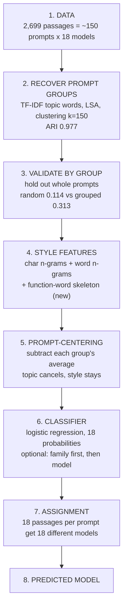

# What the "Name That LLM" workbook does (under the hood)

This file explains the method and the model versioning. For how to install and run things, see the [README](README.md).
The notebook `notebooks/name_that_llm.ipynb` explains the method with simple code and is not connected to the pipeline; your original version is in git history (first commit).

## Folder guide

```
ML Ops Final/
├─ README.md, CONTRIBUTING.md   how to run it, how to contribute
├─ WORKBOOK_EXPLAINED.md        this file
├─ notebooks/   name_that_llm.ipynb      simple, self-contained explanation of the method
├─ src/name_that_llm/                    the real code (grouping, features, model, train, tune, registry, predict)
├─ api/         FastAPI service that serves the model
├─ dags/        Airflow pipeline: group -> tune -> train -> evaluate -> register
├─ docker/, Dockerfile, docker-compose.yml   images for the API, MLflow, Airflow
├─ tests/       unit and end-to-end tests on made-up data
├─ data/        train.csv, test.csv (not in git), train_with_groups.csv, embeddings/ (saved DistilBERT numbers)
├─ artifacts/   latest trained model, best_params.json, metrics.json (not in git)
├─ figures/     flow chart, 2D model charts, notebook plots
└─ research/    usenixsecurity25-pasquini.pdf
```

## 0. The whole thing in one picture


Same flow as text (renders as a diagram in GitHub or in VS Code with a Mermaid extension):



**Score ladder** (balanced accuracy, grouped CV, chance = 0.056):
plain 0.309 → + centering 0.381 → + assignment 0.422 → + skeleton features 0.466 → logistic regression C=1 0.477 → + 10% DistilBERT blend **0.521**.

**Plain-English summary:** the same 150 questions were put to 18 AIs. The test uses new questions, so we can't learn "topic → AI". Instead we find which passages answer the same question, subtract what they have in common (the topic), and look at what's left: each AI's writing habits. Then we use the rule "each AI answers each question once" to clean up the guesses.

## 1. The problem

**Authorship attribution for LLMs.** Given a short prose passage, predict which of **18 LLMs** wrote it.

| File | Contents |
|---|---|
| `data/train.csv` | 2,699 rows: `id, prompt_id, text, model` |
| `data/test.csv` | only 3 rows here (a tiny sample): `id, text` only (no model, no prompt) |
| `data/train_with_groups.csv` | train + a recovered `group` column (made by `python -m name_that_llm.grouping`) |
| `figures/group_recovery.png`, `figures/grouped_cv_baseline.png` | figures from the first version of the notebook |

### The hidden structure
The data was generated as **~150 prompts × 18 models, one answer each** (150 × 18 ≈ 2,700; one model has 149 rows). So passages come in "families": the 18 answers to the same prompt discuss the same topic and differ only in author style.

The **test set uses unseen prompts**. Consequences:

1. A classifier that learns "topic X → model Y" is useless on test. Only style transfers.
2. Honest validation must hold out **whole prompts** (GroupKFold), not random rows.
3. Within one prompt, all 18 answers come from 18 *different* models. That is a constraint we can exploit.

## 2. Pipeline

```
text ──► TF-IDF (content words) ──► LSA 200-d ──► agglomerative clustering (k≈150)
                                                         │
                                          recovered prompt groups  (ARI 0.977)
                                                         │
          ┌──────────────────────────────────────────────┼─────────────────────────┐
          ▼                                              ▼                         ▼
 GroupKFold validation                      prompt-centering of features    Hungarian assignment
 (honest score)                             (remove topic, keep style)      (1 model per slot)
```

### Step A. Recover the prompt groups (notebook section 2)
- **Topic vector:** TF-IDF restricted to *content* words (stopwords removed, `max_df=0.05` drops anything common, alphabetic ≥3 letters), then **TruncatedSVD to 200 dims** (LSA) and L2-normalise. Style words are deliberately removed so passages cluster by *subject*, not author.
- **Clustering:** `AgglomerativeClustering(metric="cosine", linkage="average")`.
- **Choosing k without labels:** `quality()` uses the known structure: a perfect cluster has ~18 passages and no model twice. Sweep result:

| k | clusters w/ a repeated model | clusters of size 15–21 | singletons |
|---|---|---|---|
| 123 | 17.9% | 82% | 0 |
| 146 | 4.8% | 95.9% | 1 |
| **150** | **2.7%** | **95.3%** | 2 |
| 168 | 2.4% | 85% | 13 |
| 225 | 0.9% | 58% | 47 |

  Too few clusters → different prompts merge (repeats). Too many → prompts split (singletons). k = 146–150 balances both.
- **Grading:** train.csv happens to include the true `prompt_id`, so **ARI = 0.977** against it (1.0 = perfect). The label-free purity metrics agree, which is what makes the method trustworthy for the test set, where no prompt ids exist.

### Step B. Why validation must be grouped
Baseline model: char 2–5-gram TF-IDF + class-balanced logistic regression, scored by balanced accuracy (chance = 1/18 = 0.056).

| Split | Balanced accuracy |
|---|---|
| Random 5-fold | **0.114** |
| GroupKFold (recovered prompts) | **0.313** |

Random CV scores *lower*, not higher, which is the opposite of normal leakage. Reason: with random splits, the other 17 answers to the held-out passage's prompt sit in training labelled with *other* models. The classifier learns "this topic ⇒ not this model" and is pushed away from the truth. Either way a random split misestimates test performance, so all later numbers use GroupKFold.

### Step C. Extra style features, a negative result
Adds function-word rates, punctuation/markdown counts, sentence/word length, and the first three words. Score **0.283 < 0.313**. More hand-made features hurt with only ~2.7k samples; the markdown features are almost always zero here (plain prose), while em-dash/semicolon/colon appear in 39–52% of passages.

The "top phrases" table (one logistic regression on word 1–2-grams) shows each model's most distinctive tokens, e.g. Gemini → "profound", "fundamental"; GPT-5.6 variants → "may", "merely". Treat it as tendencies, since many top tokens are function words.

### Step D. The main improvement (centering and assignment)
Features: char n-gram TF-IDF (20k) + word 1–2-gram TF-IDF (15k), densified, fit on the training fold only.

1. **Prompt-centering.** For every prompt group, subtract that group's mean feature vector from each member. All 18 answers share the topic, so the topic's contribution is the group mean and cancels; what remains is each author's deviation, which is style.
2. **One-to-one assignment.** Take the classifier's probabilities `P` for the passages in a group, build cost `-log P`, and solve the assignment problem (`scipy.optimize.linear_sum_assignment`, a.k.a. Hungarian algorithm). That forces the 18 passages to get 18 distinct models, maximising total likelihood instead of taking each argmax independently.

| Variant (5-fold GroupKFold) | Mean | Std |
|---|---|---|
| plain | 0.309 | 0.007 |
| + centering | 0.381 | 0.013 |
| + centering + assignment | **0.422** | 0.010 |

So each trick adds roughly +0.07 and +0.04 respectively; ~7.5× chance.

### Step E. Two-stage classifier and "skeleton" features (an experiment, not in the notebook)
Same 5-fold GroupKFold, so numbers compare directly with Step D.

- **New feature block, "function-word skeleton".** Every word outside the 150 most common becomes `W`; punctuation stays. `The cat sat; it was warm.` → `the W W ; it was W .` Its 1–4-grams describe sentence rhythm and syntax with almost no topic.
- **Two-stage classifier.** Stage 1 guesses the family (Claude, Gemini, GPT, GLM, Kimi, Qwen, from the model-name prefix). Stage 2 uses a separate classifier per family. Final probability = P(family) × P(model | family), then assignment.

| Features | Classifier | Centred | Centred + assignment |
|---|---|---|---|
| Old (char + word) | flat | 0.381 | 0.422 |
| Old | two-stage | 0.376 | 0.433 |
| **New (+ skeleton)** | flat | **0.431** | **0.466** |
| New | two-stage | 0.428 | 0.465 |

- **Skeleton features help:** about +0.045, better in all 5 folds (+0.02 to +0.064).
- **Two-stage doesn't clearly help:** +0.011 with old features, 0 with new, and it swings from −0.033 to +0.028 between folds. Stage 1 names the right company only ~73% of the time, and those mistakes can't be repaired in stage 2.
- **Recommended setup so far:** new features + flat classifier + centering + assignment = 0.466.

### Step F. 2D charts of the models (what they do and don't show)
| Chart | File | What it is | Explainable? |
|---|---|---|---|
| PCA, topic | `figures/models_2d_topic.png` | Models fully mixed: topic says nothing about author | Axes = subject matter (PC1 1.5%, PC2 1.3% of variance) |
| PCA, style | `figures/models_2d_style.png` | Gemini separates; the rest overlap | Axes readable via n-gram loadings (PC1 0.8%, PC2 0.7%) |
| t-SNE, style | `figures/models_2d_tsne.png` | Gemini separates, mild order among the others | **No**: axes and distances between clusters have no meaning |
| LDA, style | `figures/models_2d_lda.png` | Three chunks: Gemini / GPT+Kimi+Qwen / Claude+GLM | Yes (linear), but fitted in-sample so it looks tidier than reality |

Takeaway: the models cluster into families, while telling models apart inside a family is the hard part. The 2D charts show only a thin slice (PCA axes cover ~1.5% of style variance), so overlap in 2D doesn't mean the models are inseparable in the full feature space. For honest accuracy, use the cross-validated scores, not how clean a picture looks.

### Step G. Better models and ensembles (experiments, with the winner in the notebook)
Same 5-fold GroupKFold. Baseline = skeleton features, centring, assignment.

| Idea | Score | Verdict |
|---|---|---|
| Logistic regression C=1 instead of 5 | 0.477 | small gain, kept |
| Linear SVM / averaging LR + SVM | 0.466 | no help |
| Averaging per-feature-block models | 0.474 | no help (same kind of signal) |
| MiniLM embeddings alone | 0.205 | weak |
| DistilBERT embeddings alone | 0.396 | weaker than TF-IDF |
| TF-IDF + 50/50 embeddings | worse | hurts |
| **TF-IDF + 10% DistilBERT** | **0.521** | better in 5/5 folds, kept |
| TF-IDF + 20% / 30% DistilBERT | 0.503 / 0.473 | too much weight hurts |

The DistilBERT weight was picked on the same folds, so 0.521 is a little optimistic (a realistic gain is perhaps +0.02 to +0.04). This blend is section 7 of the notebook. These scores are local cross-validation estimates, not Kaggle scores.

Tuning with Optuna did **not** help once checked honestly. Scored on the folds that picked the settings it reached 0.532,
but tuning inside each fold and testing on untouched prompts (`python -m name_that_llm.tune --nested`) gives 0.520 for
both the hand-picked and the tuned settings: in four of five folds the search simply kept the hand-picked values.
That check used 6 trials and 3 inner folds, a lighter search than the 12-trial run.

## 3. Things to know
- **Test-time requirement.** Centering and assignment both need the test passages grouped by prompt. You must cluster `data/test.csv` with the same recipe (it's small, so check the cluster sizes carefully: assignment assumes ≤18 per group, and 18 distinct models per group).
- **`prompt_id` is only used for grading** the clustering (ARI). The pipeline itself never reads it.
- **The research PDF (`research/usenixsecurity25-pasquini.pdf`) is *LLMmap* (USENIX Security 2025).** It fingerprints 42 LLM versions at >95% accuracy, but with chosen probe questions and ~8 responses per model, so it is an easier setup than one free-form passage. Ideas that transfer: e5 embeddings (`multilingual-e5-large-instruct`) feeding a small transformer, contrastive training, and pooling several samples (your assignment step does a version of this). It does **not** contain the markdown, function-word or first-word features, and its Fig. 6 is a 2D map of learned signatures, not a phrase list. So the notebook's comments "style features from the paper" and "paper Fig. 6" must refer to some other paper, which I haven't identified.
- **Not done yet:** contrastive training, a run on the real test set, and e5 embeddings in the blend. (The skeleton features and the DistilBERT blend are in the notebook and the package; the two-stage classifier was dropped.)
- **Notebook and package.** The notebook is an explanation with its own simplified code. It is not connected to the
  package, Airflow, Optuna or the registry, so running it does not change the model the API serves.
- **Next steps listed by the author:** e5 + contrastive training, two-stage (organization → model), MLflow logging of `cv_scheme`, `k`, `cluster_quality`.

## 4. How to re-run
See the [README](README.md): section A for plain Python, section B for Docker. The notebook reads `../data/train.csv`
and builds dense ~35k-column matrices, so give it a few GB of RAM.

## 5. Model versioning: how it works

**The problem it solves.** Every retrain produces a new model file. Without versioning you cannot say which model is
serving, how good it was, what settings made it, or go back to the one that worked yesterday. Retraining could also
silently replace a good model with a worse one. The registry fixes this by keeping every model as a numbered version and
promoting a new one only if it earns it.

**The tool.** MLflow's *Model Registry* (a page at http://localhost:5000 in Docker). It stores three things:

| Piece | What it is |
|---|---|
| **Run** | One training event: the settings (`style_c` ...), the scores, the model file, `metrics.json`, `best_params.json` |
| **Model version** | A numbered copy of the model (1, 2, 3 ...) linked to the run that made it, with tags |
| **Alias `champion`** | A movable label on one version: "this is the one in service" |

**Two version numbers, on purpose.**
- The **registry number** (1, 2, 3 ...) is automatic and only goes up. It is the exact identity of a model.
- The **semantic version** (`0.1.2`) tells people how big a change was. `0.1` comes from `__version__` in
  `src/name_that_llm/__init__.py`: raise it by hand when the features or the model code change (a different kind of model).
  The last digit goes up by one automatically on every retrain under the same `0.1`, which is the "same recipe, new
  training run" case.

**What happens on a retrain** (the Airflow task `register_model`, or `python -m name_that_llm.registry`):

```
train + cross-validate  ->  candidate model, score 0.531
           |
           v
register as the next version   -> registry #3, semver 0.1.2, tags: score, status
           |
           v
compare with the champion's stored score
     |                                   |
  at least as good                    worse
     |                                   |
alias "champion" moves to #3         #3 is kept but tagged "not promoted"
old champion tagged "retired"        the champion does not change
```

**An example history** (illustrative numbers):

| Registry # | Semver | Score | Status |
|---|---|---|---|
| 1 | 0.1.0 | 0.520 | retired |
| 2 | 0.1.1 | 0.505 | not promoted (worse than #1) |
| 3 | 0.1.2 | 0.531 | **champion** |

**How the API uses it.** On startup it loads `models:/name_that_llm@champion`, and `GET /health` reports the version it
loaded. If MLflow is unreachable or has no champion yet, it falls back to `artifacts/model.joblib`. After a new champion is
promoted, restart the API to pick it up.

**Rolling back.** Set `MODEL_VERSION=1` for the API and restart it, which serves version 1 whatever the alias says.
To make the rollback permanent, point the `champion` alias back at that version in the MLflow page.

**Things to know about the promotion rule.**
- Scores compare fairly only while the data and the prompt groups are the same. If the training data changes, the old
  champion's stored score is out of date.
- Fold-to-fold scores wobble by about 0.02, so a difference of 0.003 is noise. With the default `--min-gain 0`, a tie
  promotes the newer model. Use `--min-gain 0.01` to demand a real improvement before anything changes.
- The registry stores the model file as an artifact and does not run it. It is the record of what exists and what is in service.
